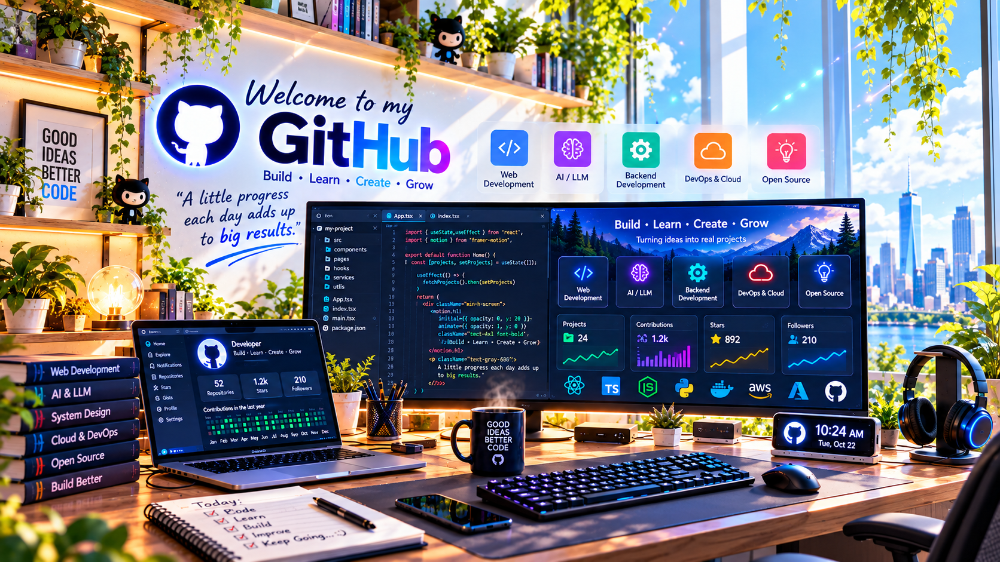
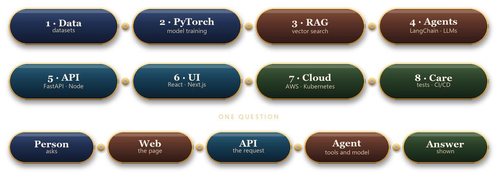

  

<h2>Software Engineer</h2>

<picture>
  <source media="(prefers-color-scheme: dark)" srcset="https://readme-typing-svg.demolab.com?font=Playfair+Display&size=28&duration=2600&pause=800&color=F0C36A&center=true&vCenter=true&width=720&height=56&lines=AI+%2F+ML+%C2%B7+8%2B+years;TypeScript+and+Python;Models%2C+APIs%2C+and+cloud">
  
</picture>

 

I build AI products that run in production, from the model and the data to the API, the UI, and a deploy on AWS or Kubernetes.
 
I write them in TypeScript and Python, and I keep them tested and easy to maintain.

<table>
  <tr>
    <td align="center" width="33%">
      <h3>8+ years</h3>
      Web, cloud, and machine learning, shipped for people to use
    </td>
    <td align="center" width="33%">
      <h3>The whole path</h3>
      Data, model, API, UI, then AWS and Kubernetes
    </td>
    <td align="center" width="33%">
      <h3>After launch</h3>
      Tests, edge cases, and code that stays easy to change
    </td>
  </tr>
</table>

<h2>Core Skills</h2>

<table width="100%">
  <tr>
    <th align="left" width="200">Area</th>
    <th align="left">Tools</th>
  </tr>
  <tr>
    <td valign="middle"><b>Languages</b></td>
    <td valign="middle">
      &nbsp;
      &nbsp;
      &nbsp;
      
    </td>
  </tr>
  <tr>
    <td valign="middle"><b>Web</b></td>
    <td valign="middle">
      &nbsp;
      &nbsp;
      &nbsp;
      
    </td>
  </tr>
  <tr>
    <td valign="middle"><b>Data</b></td>
    <td valign="middle">
      &nbsp;
      
    </td>
  </tr>
  <tr>
    <td valign="middle"><b>Cloud & DevOps</b></td>
    <td valign="middle">
      &nbsp;
      &nbsp;
      &nbsp;
      
    </td>
  </tr>
  <tr>
    <td valign="middle"><b>AI / ML</b></td>
    <td valign="middle">
      &nbsp;
      &nbsp;
      &nbsp;
      &nbsp;
      
    </td>
  </tr>
</table>

<h2>Workflow</h2>

From the dataset to a deploy, then one question through the agent.

 

<h2>Contact</h2>

<picture>
  <source media="(prefers-color-scheme: dark)" srcset="https://readme-typing-svg.demolab.com?font=Playfair+Display&size=26&duration=2200&pause=800&color=F0C36A&center=true&vCenter=true&width=420&height=50&lines=Say+hello;Gmail;LinkedIn;Portfolio">
  
</picture>

 

&nbsp;&nbsp;

&nbsp;&nbsp;

  

<i>A little progress each day adds up to big results.</i>

